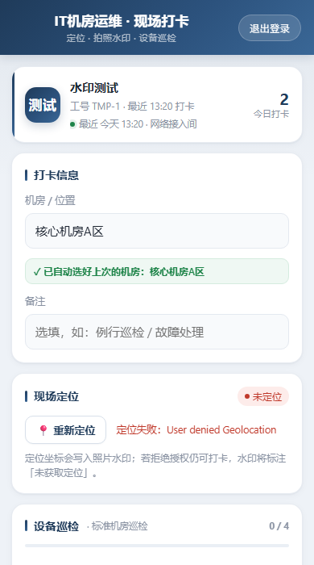
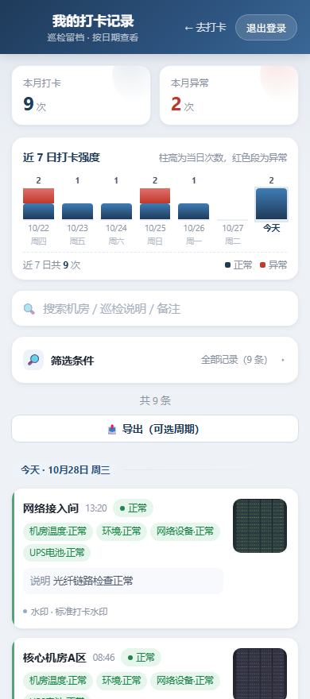
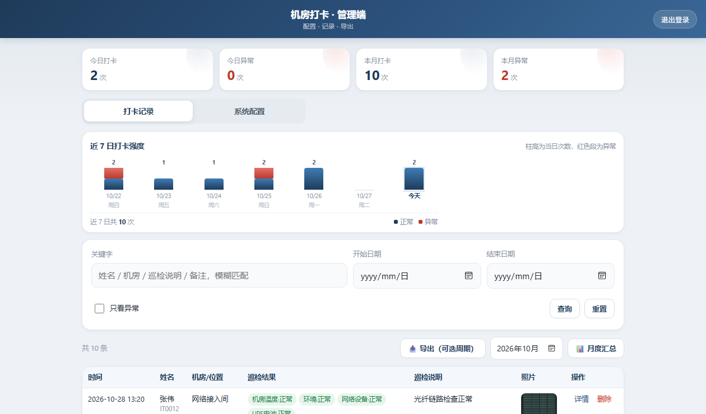
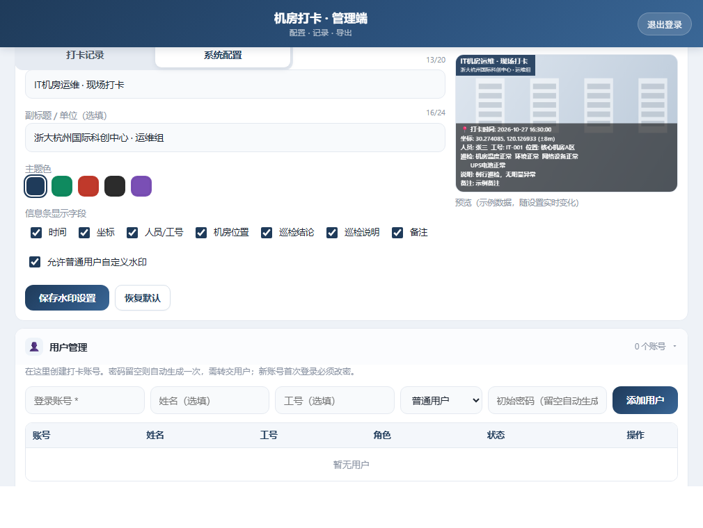
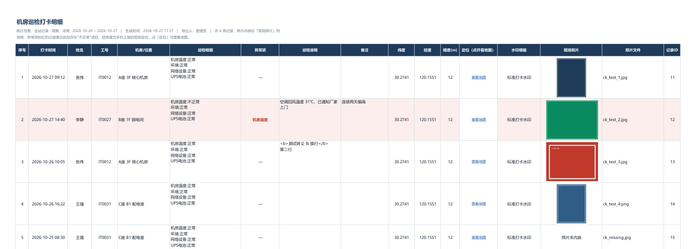
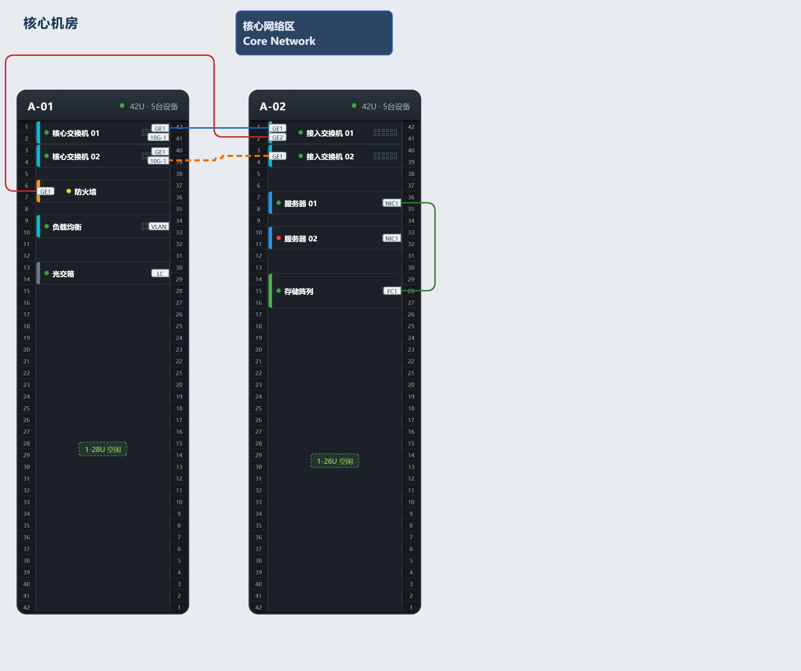

# IT 机房运维 · 现场打卡服务（迁移部署包）

移动端 H5 + Node/SQLite 轻量后端，内置机柜连线拓扑编辑器，附带微信小程序源码。
本包为**通用迁移版**：不含任何真实数据、密钥、证书与固定密码，可在任意机器、任意目录全新部署。

> **在线演示**：https://it-xiao-word.github.io/it-checkin-migrate/demo/ （纯前端，无需部署，数据存本机浏览器）
> **图文介绍**：https://it-xiao-word.github.io/it-checkin-migrate/

### 界面预览

| 移动端打卡 | 我的记录 | 管理端 |
|---|---|---|
|  |  |  |

| 水印配置 | Excel 导出 | 机柜拓扑 |
|---|---|---|
|  |  |  |

### ☕ 支持作者

如果这个工具帮你省了时间，欢迎扫码请作者喝杯咖啡，你的支持是持续维护的动力：


---

## 一、包内有什么

| 文件/目录 | 说明 |
|---|---|
| `server.js` | Express 服务（HTTP + 可选 HTTPS），含打卡/记录/管理/拓扑等全部接口 |
| `db.js` | SQLite 数据层，首次运行自动建表并初始化示例数据 |
| `export-html.js` / `export-xlsx.js` | 导出模块（XLSX 内嵌照片） |
| `public/` | Web 前端全部页面与本地化依赖（html2canvas/jsPDF/SheetJS，离线可用） |
| `miniprogram/` | 微信小程序源码（与 Web 共用本后端） |
| `package.json` / `package-lock.json` | 依赖声明与锁定 |
| `.env.example` | 环境变量模板 |
| `install.sh` | 一键部署脚本（Linux） |
| `demo/` | 纯前端静态演示（GitHub Pages 用，可本地直接打开体验） |
| `screenshots/` | 界面截图 |
| `README.md` | 本文档 |

**不含**：`data/`（数据库、JWT 密钥）、`uploads/`（打卡照片）、`certs/`（证书）、`node_modules/`。
这些数据首次运行会自动创建，迁移旧数据时按第五节导入。

---

## 二、环境要求

- **Node.js >= 18**（含 npm）：https://nodejs.org
- 可选：**openssl**（生成自签 HTTPS 证书时用）
- 可选：**systemd**（开机自启用；无它也能前台/后台运行）
- 依赖：express / multer / better-sqlite3（`npm ci` 自动安装，better-sqlite3 需编译环境或预编译包）

---

## 三、最快部署（Linux，一键）

把整个目录上传到服务器，例如 `/tmp/it-checkin`，然后：

```bash
cd /tmp/it-checkin
sudo bash install.sh
```

脚本会交互询问安装目录（默认 `/opt/it-checkin`）、是否生成自签证书、是否注册 systemd。
全自动（适合脚本化批量部署）：

```bash
sudo APP_DIR=/opt/it-checkin AUTO=1 bash install.sh
```

完成后管理端地址：`http://服务器IP:3000/admin.html`

---

## 四、手动部署（任意系统，含 Windows）

```bash
# 1) 进入包目录，安装依赖
cd it-checkin
npm ci --omit=dev

# 2) 直接启动（HTTP，端口 3000）
node server.js

# 3) 指定端口
PORT=8080 node server.js

# 4) 启用 HTTPS（需自备证书）
SSL_KEY=/path/key.pem SSL_CERT=/path/cert.pem node server.js
```

Windows PowerShell 指定环境变量：

```powershell
$env:PORT=8080
node server.js
```

首次启动会生成初始管理员密码（仅一次），可通过两种方式获取：
1. 启动控制台输出：`[初始化] 初始密码: xxxx`
2. 文件 `data/first_password.txt`（权限 600，仅管理员可读）—— 错过控制台也能找回

账号为 `admin`，首次登录会强制跳转到改密页。**改密后请删除 `data/first_password.txt`**，避免明文密码留存。若密码遗失且尚未改密，可按第五节重建数据库重新生成。

---

## 五、迁移旧数据（关键）

新环境首次启动后，把旧服务器的 `data/` 与 `uploads/` 复制过来，重启服务即可，**账号、打卡记录、照片、拓扑、水印全部保留**：

```bash
# 在旧服务器打包
cd /旧目录/it-checkin && tar czf itck-data.tar.gz data uploads

# 传到新服务器并解包覆盖（先停服务）
sudo systemctl stop it-checkin
tar xzf itck-data.tar.gz -C /opt/it-checkin
sudo systemctl start it-checkin
```

> `data/checkin.db` 是数据库，`data/.jwt_secret` 是会话签名密钥——两者必须一起迁移，否则已登录会话会失效（重新登录即可，但令牌会重置）。
> `data/` 与 `uploads/` 应纳入日常备份。

---

## 六、HTTPS 与手机访问

手机使用 **GPS 定位** 和 **摄像头** 必须由 HTTPS 提供（HTTP 下浏览器会拒绝）：

- 内网临时用：用 `install.sh` 生成自签证书，手机首次访问手动信任；
- 正式对外：用受信任的证书（如 Let's Encrypt），配置 `SSL_KEY` / `SSL_CERT` 后重启；
- 微信小程序正式版：必须是**已备案域名 + 受信任证书**，并在 mp 后台登记服务器域名，不支持纯 IP/自签。

---

## 七、配置参考

所有配置通过**环境变量**注入（`server.js` 不自动读取 `.env` 文件；`install.sh` 会生成 systemd 的 EnvironmentFile）：

| 变量 | 默认 | 说明 |
|---|---|---|
| `PORT` | 3000 | HTTP 端口 |
| `SSL_PORT` | 3443 | HTTPS 端口（有证书才启用） |
| `SSL_KEY` | 空 | HTTPS 私钥路径 |
| `SSL_CERT` | 空 | HTTPS 证书路径 |
| `INIT_ADMIN_PASSWORD` | 随机 | 仅在空库初始化时生效；不填则随机生成并打印 |

---

## 八、常用运维

```bash
# 服务状态 / 日志
systemctl status it-checkin
journalctl -u it-checkin -f

# 重启 / 停止
systemctl restart it-checkin
systemctl stop it-checkin

# 备份数据与照片
tar czf ~/itck-backup-$(date +%F).tar.gz -C /opt/it-checkin data uploads

# 导出：管理端页面内下载 XLSX（照片内嵌）/ HTML
```

---

## 九、安全建议

- 首次登录后**立即修改管理员密码**；
- 对外服务务必启用 HTTPS，并限制访问来源（防火墙/安全组）；
- `data/`、`.env`、`certs/` 权限设为仅管理员可读；
- 定期备份 `data/` 与 `uploads/`；
- 升级时用 `install.sh`，它会保留已有数据与上传文件。

---

## 十、小程序端

`miniprogram/` 用微信开发者工具导入即可。上线前修改 `miniprogram/config.js` 顶部的 `PROD` / `DEV` 为你的服务器地址（当前为占位符）。小程序与 Web 共用同一后端，无需另建服务。
